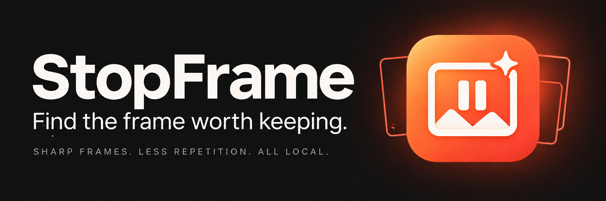

# StopFrame

[English](README.md) · [Русский](README.ru.md)

Открытие папки заменяет список файлов, останавливает прежний отбор и очищает старые кадры и превью. Все настройки и логотипы сохраняются. «Добавить файлы» дополняет текущую сессию. Уже экспортированные файлы остаются на диске.

Параметры экспорта находятся в компактной панели по кнопке «Параметры» вверху справа на вкладке «Кадры и экспорт», рядом с переключателем логотипа. Там задаются префикс, его положение, формат и качество JPEG; изменения сразу сохраняются. Первая вкладка заканчивается автоматическим отбором.

Фотографии JPEG, PNG, WebP, TIFF, BMP и HEIC/HEIF (macOS) сразу появляются на вкладке обработки, без отбора и создания скриншотов. Учитывается ориентация EXIF. Для пропорций 16:9 выбираются соответствующие горизонтальные или вертикальные логотипы, для остальных — шаблоны 4:3. Доступны обычные настройка логотипа, поворот и экспорт. Фотографии сохраняются рядом с оригиналами с исходным именем, заданным префиксом и форматом; при пустом префиксе используется `logo`. Исходники и существующие файлы не перезаписываются. Экспорт кадров из видео по-прежнему идёт в подпапку `logo` выбранной папки.

Локальное приложение для macOS, которое помогает получать из видео резкие и разнообразные изображения. Кадры можно отбирать автоматически или вручную на временной шкале, а перед экспортом добавлять логотип.

**навайбкодил- @sirdimitry** · [Версия](VERSION) · [Сборка для macOS](docs/BUILDING.md)

## Возможности

- **Автоматический отбор:** оценка резкости, проверка открытых глаз и закрытого рта у обнаруженных лиц, поиск соседних моментов вместо кадров с морганием и исключение визуально похожих кадров. Указанные 1–5 кадров — максимум: статичная сцена может дать один кадр, а неподходящее видео — ни одного.
- **Проверка лиц:** Apple Vision на Apple Silicon с поддерживаемыми этапами Neural Engine на macOS 14+ и автоматическим распределением вычислений на macOS 13. MediaPipe включён как резервный вариант. Проверяются оба глаза и обнаруженные рты. Если проверка недоступна, приложение сообщает об этом и продолжает отбор по резкости и разнообразию. Распознавание приблизительное; результат стоит просмотреть.
- **Производительность:** декодирование AVFoundation и изображения с максимальной стороной 960 пикселей для анализа; превью карточек до 640 пикселей; не более двух одновременных задач в каждой очереди лент, превью и экспорта; ограниченное число потоков декодеров; кеш логотипов до 64 МиБ. Экспорт сохраняет исходное разрешение и использует прежний декодер. Разные разрешения анализа и модели могут выбирать разные моменты.
- **Временная шкала:** миниатюры с сохранением пропорций, отметки выбранных кадров, живое превью, покадровая навигация и захват кадра клавишей Space.
- **Логотипы:** сопоставление PNG-шаблонов из папки с соотношением сторон, ориентацией и расположением слева или справа. По умолчанию используется левый вариант; при просмотре можно менять сторону, соотношение сторон шаблона, смещение и масштаб.
- **Библиотека логотипов:** управление папкой в Settings → Logo Library или через компактный индикатор рядом с переключателем Logo на вкладке просмотра. Зелёный индикатор означает наличие шаблонов; отсутствующие файлы обнаруживаются. Основная вкладка остаётся посвящена импорту и анализу видео. Окно запоминает размер.
- **Просмотр результата:** группировка кадров, выбор нескольких кадров и диапазонов, поворот по часовой стрелке шагами по 90°, удаление, увеличение и дополнительная коррекция цвета HDR. Поворот применяется к выбранным кадрам и экспорту; четыре нажатия возвращают исходную ориентацию. Шаблон логотипа соответствует ориентации кадра и остаётся вертикальным.
- **Предпросмотр:** коррекция HDR, поворот на 90° по часовой стрелке, выбор стороны логотипа и настройка его положения и масштаба прямо в окне просмотра. Кнопки «Предыдущий» и «Следующий» (Alt+←/→) переходят по порядку карточек между всеми видео. Изменения сразу отражаются в карточках и экспорте.
- **Экспорт:** PNG или JPEG в исходном разрешении, настраиваемый префикс имени, включение и отключение логотипа, выбор папки назначения. Изображения сохраняются в её подпапку `logo`.

## Попробуйте StopFrame

Если вы работаете с видео, приглашаю установить StopFrame и попробовать его на своих материалах: отберите кадры из целой папки, уточните нужные моменты на временной шкале, поверните и просмотрите результат, добавьте логотип и экспортируйте изображения в исходном разрешении. Всё обрабатывается локально на вашем Mac.

Скачайте актуальный установщик в [GitHub Releases](https://github.com/sirdimitry/stopframe/releases). Если приложение оказалось полезным, буду благодарен за **звезду этому репозиторию** — это поддерживает проект и помогает другим его найти. Обратная связь тоже очень ценна: [сообщите об ошибке или предложите функцию](https://github.com/sirdimitry/stopframe/issues), поделитесь проектом с теми, кому он может пригодиться, или предложите улучшение кода. Спасибо, что попробовали!

## Установка на Mac

Откройте `StopFrame-<version>-macOS-arm64.dmg` и перетащите **StopFrame** в **Applications**.

Текущая сборка предназначена для **Apple Silicon (M1 и новее), macOS 13 и новее**. Она проверяется на Mac, где выполняется сборка, а не на каждой поддерживаемой версии системы. Python включён в приложение; настраивать Terminal для использования не требуется.

Локальная сборка имеет ad-hoc подпись, без нотарификации Apple. После первой попытки запуска macOS может потребовать выбрать **Системные настройки → Конфиденциальность и безопасность → Всё равно открыть**. Сборки для Intel и нотарифицированная дистрибуция не входят в этот сценарий сборки.

## Запуск из исходников

```bash
python3.12 -m venv .venv
.venv/bin/python -m pip install -r requirements.txt
.venv/bin/python main.py
```

Для включённой проверки лиц через MediaPipe используйте Python 3.12. На Python 3.13+ эта дополнительная зависимость пропускается.

На Apple Silicon перед запуском из исходников можно собрать нативный помощник проверки лиц: `.venv/bin/python scripts/build_native.py`. В релизных сборках он включается автоматически. Сравнить прежний и оптимизированный анализ можно командой `.venv/bin/python scripts/benchmark.py /path/to/videos --count 8`.

## Версии

[VERSION](VERSION) — единый источник версии для окна About, метаданных приложения macOS и имени DMG. Изменение кода или Git-коммит **не меняет версию автоматически**.

Чтобы увеличить версию и собрать релиз:

```bash
.venv/bin/python scripts/build_macos.py --bump
```

Для повторной сборки той же версии уберите `--bump`. Можно отдельно запустить `scripts/bump_version.py`. Схема — `MAJOR.MINOR.PATCH`: после 20 значение patch сбрасывается с увеличением minor, после 10 значение minor сбрасывается с увеличением major.

## Локальная обработка

Чтение видео, анализ кадров, наложение логотипов и экспорт выполняются на вашем Mac. Учётная запись и загрузка материалов в интернет не нужны. Настройки, кеш миниатюр и журнал находятся в `~/Library/Application Support/StopFrame`. Журнал может содержать имена медиафайлов и сведения об ошибках; приложение никуда его не отправляет.

## Разработка

```bash
.venv/bin/python -B -m unittest discover -s tests -v
.venv/bin/python main.py --self-test
```

Приложение использует PySide6, OpenCV, NumPy, Pillow и дополнительный MediaPipe. Инструкции по упаковке и проверке — в [BUILDING.md](docs/BUILDING.md), исходные описания для оформления — в [branding prompts](docs/branding/PROMPTS.md).
